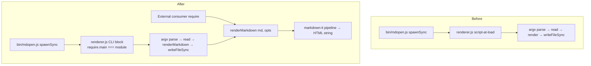

# Architecture: MDOP-001

## Overview

Restructure `renderer.js` from a script that runs its entire pipeline at module load into an exported `renderMarkdown(md, opts)` function with a CLI wrapper that preserves the existing argv contract. The function parameterizes image resolution so the same rendering pipeline serves local-file consumers (current CLI behavior) and HTTP consumers (future quick-share integration) without forking. No new files, no new dependencies, no other module changes — the redesign is bounded to `renderer.js`.

`package.json` already declares `"main": "renderer.js"`; this design makes the file fulfill that existing claim rather than introducing a new library role.

## Pattern

**Extract Function, Keep Entry Point** — lift the pipeline into a parameterized pure-ish function; keep the argv-parsing and file-I/O shell as a CLI-only block guarded by a direct-invocation check.

Rationale: the rendering pipeline (markdown-it config → frontmatter extraction → callout enhancement → template substitution) is reusable logic; argv parsing, `readFileSync`, and `writeFileSync` are transport details. Separating them is the smallest change that makes the pipeline callable.

## Module Boundaries

### Owner: `renderer.js`

Remains the single owner of markdown → HTML rendering. Before: script invoked via `spawnSync` from `bin/mdopen.js`. After: module that exports `renderMarkdown` and runs the CLI path only when invoked directly.

Boundary change: callers can now `require('./renderer.js')` and get the export. The subprocess call in `bin/mdopen.js` (line 164) stays unchanged — the CLI block in `renderer.js` still accepts the same argv and writes the same file.

### Unchanged: `bin/mdopen.js`

No changes. Still calls `renderer.js` via `spawnSync(process.execPath, [renderer, input, template, output, title, "mdopen.css", defaultStyle])`. The CLI wrapper inside `renderer.js` preserves this contract.

### Unchanged: `templates/`, `assets/`

Template files and CSS are read at the same paths, in the same order. The only change is *who* reads them moves from module-load scope into the function or CLI block.

## Decisions

### D1: Function signature

```text
renderMarkdown(markdown, options) → { html, hasMermaid }
```

Options:
- `template` (string, required) — pre-loaded template HTML string
- `templateDir` (string, required) — directory containing `mdopen-script.html` and `mermaid-script.html`, read during substitution
- `pageTitle` (string, required)
- `cssHref` (string, required)
- `defaultStyle` (string, default `"default"`)
- `resolveImage` (function, optional) — `(src) => resolvedSrc`. If omitted, relative `src` is left unchanged.

Return: `{ html, hasMermaid }` — `hasMermaid` tells the caller whether to inject the mermaid script (mirrors current `hasMermaid` flag logic at lines 51/166).

Rationale for `resolveImage` callback over a `context` flag or `imageBaseUrl`:
- The current CLI behavior is `path.resolve(inputDir, src)` — a callback `((src) => path.resolve(inputDir, src))` expresses this exactly
- An HTTP consumer passes `((src) => new URL(src, baseUrl).href)` — no new pattern invented
- A consumer that wants images untouched passes nothing (or identity)
- Avoids encoding a `file | http` enum that would grow as new contexts appear; the callback is the seam

### D2: CLI wrapper guard

```text
if (require.main === module) {
  // argv parse, readFileSync, call renderMarkdown, writeFileSync
}
```

This is the standard CommonJS direct-invocation check. `bin/mdopen.js` spawns `renderer.js` as a subprocess, so `require.main === module` is true for CLI invocation and false when another module `require`s it.

### D3: Image resolution parameterization

The current image rule (lines 86–98) is inlined:

```text
md.renderer.rules.image = (tokens, idx, options, env, self) => {
  ...
  token.attrs[srcIndex][1] = path.resolve(inputDir, src);
  ...
};
```

After: the rule calls `resolveImage(src)` when provided, otherwise leaves `src` untouched. The CLI block passes `resolveImage: (src) => path.resolve(inputDir, src)` to preserve current behavior exactly.

### D4: File structure — stay in `renderer.js`

No new file. `package.json` `"main"` already points to `renderer.js`; ARCHITECTURE.md §Constraints values script-sized, local changes. Splitting into `lib/render.js` would be more "library-like" but adds a file and a path for no functional gain in this CR. The consolidation of the three markdown-it config copies (renderer, directory viewer, editor) is a follow-up that may revisit this.

### D5: Repo boundary — deferred

This CR exposes the export. How an external consumer (quick-share) depends on it — path-require, workspace package, or published package — is a consumer-side decision that does not affect `renderer.js`'s shape. Recorded as an open question for when quick-share integration begins. The export is stable once shipped; the dependency mechanism is not.

### D6: ADR required

Write an ADR (using the `adr-writing` skill / MADR template) recording:
- Context: mdopen's rendering is CLI-only; `package.json` already declares `main: renderer.js`
- Decision: expose `renderMarkdown` as a semi-public API
- Status: semi-public — depended on by quick-share (local), not published as a stable package API
- Consequences: signature changes now affect a consumer; the ADR is the contract reference

Location: `docs/CRs/` or project ADR directory, per existing conventions (check `docs/` for an ADR pattern).

## Structure

File tree (unchanged — no new files):

```text
renderer.js          # MODIFIED: export renderMarkdown + CLI wrapper
package.json         # UNCHANGED: main already points to renderer.js
bin/mdopen.js        # UNCHANGED: still spawns renderer.js
templates/           # UNCHANGED
assets/              # UNCHANGED
docs/CRs/MDOP-001-render-api/
  architecture.md    # THIS FILE
docs/decisions/
  0001-expose-rendermarkdown-as-library-api.md  # ADR (NEW)
```

## Invariants

- CLI output parity: `bun renderer.js README.md templates/mdopen.html /tmp/out.html README mdopen.css` must produce byte-identical output before and after the refactor (baseline: 39,676 bytes captured 2026-07-11)
- `require('./renderer.js')` from another module must NOT execute argv parsing, file reads, or file writes
- No new entries in `package.json` `dependencies`
- The mermaid `.mermaid-container` / `.mermaid` structure is preserved (AGENTS.md working rule)
- `bin/mdopen.js` line 164 subprocess call requires zero changes

## Extension Rule

New rendering contexts (HTTP server, static-site generator, Slack bot) consume `renderMarkdown` with a custom `resolveImage`. They do not fork the pipeline. If a context needs to change template substitution or markdown-it config, that goes through `renderer.js` as a new option, not a new copy of the pipeline.

## Assess Mismatch Responses

From `assess.md` (Option 2: Redesign Inline):

| Mismatch | Architecture Response |
|----------|----------------------|
| `renderer.js` runs pipeline at module load | D1 + D2: extract function, guard CLI with `require.main === module` |
| Image resolution hardcoded to `path.resolve(inputDir, src)` | D3: parameterize via `resolveImage` callback |
| No verification net (only `bun run check` smoke test) | Add CLI-parity diff test (requirements §5); capture baseline output as invariant |
| `package.json main` declares library intent but file exports nothing | D1: export fulfills the existing claim |

## Verification Before Implementation

Per assess verification-gap finding, before the refactor is safe:

1. Baseline output captured (done: `/tmp/mdop001-before.html`, 39,676 bytes)
2. A test script runs the CLI path post-refactor and diffs against baseline — must be identical
3. A test script `require`s the module and calls `renderMarkdown` with a sample string — must return HTML containing expected elements without writing to disk

These are specified concretely in `mdt:tests`.

## Out of Scope

- Consolidating the three markdown-it config copies (renderer.js, directory viewer in `bin/mdopen.js`, `editor-script.html`) — follow-up CR
- quick-share integration — separate consumer-side change
- `mdopen share` subcommand — rejected
- Changing `bin/mdopen.js` to call `renderMarkdown` directly instead of spawning — the subprocess isolation is deliberate (keeps `bin/mdopen.js` simple, avoids renderer state leaking across files in directory mode); revisit only if spawn-per-file cost matters

## Diagram



## Architecture Complete

**CR**: MDOP-001
**Output**: architecture.md (this file); ADR to be written; `architecture.trace.md` deferred (no canonical requirements to anchor obligations — scope is `none`)
**Next**: `mdt:tests` — concrete verification mapping, then `mdt:tasks`
